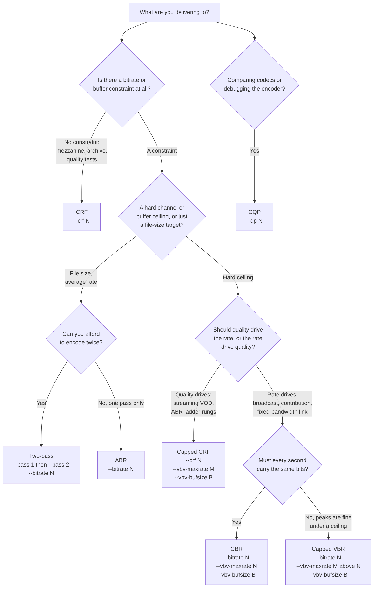
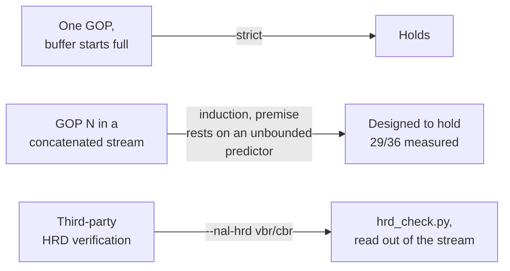

# Rate control in yah264

The rate-control mode you want depends on what you are delivering to. There
is no best one. A mezzanine file, a chunked ABR ladder, a fixed-bandwidth
contribution link and a codec experiment want four different answers. Three of
those four are wrong for the other three jobs.

This guide covers what each mode is for and what it will and will not promise.
It also marks the places where yah264 differs from x264 in ways that will
surprise you. For the bare flag list see [options.md](options.md).

The measurements quoted here come from six to eleven clips at CIF and 720p.
The equal-CRF section is the exception: it uses fifteen clips from CIF to 4K.
Where this file and the code disagree, the code wins.

## Contents

- [Picking a mode](#picking-a-mode)
- [The modes at a glance](#the-modes-at-a-glance)
- [CQP](#cqp-constant-quantiser)
- [CRF](#crf-constant-rate-factor)
- [CRF numbers against x264](#crf-numbers-against-x264)
- [ABR](#abr-single-pass-average-bitrate)
- [CBR and capped VBR](#cbr-and-capped-vbr)
- [Capped CRF, which is what VOD wants](#capped-crf-which-is-what-vod-wants)
- [Two-pass](#two-pass)
- [What VBV actually guarantees](#what-vbv-actually-guarantees)
- [Determinism](#determinism)
- [Silent failures](#silent-failures)

## Picking a mode



If you just want a good file and nothing constrains you, the answer is
`--crf`. Read the two CRF sections below before you pick the number. Both will
cost you time if you skip them.

## The modes at a glance

| Mode | Flags | Optimizes | Promises | Cannot promise |
| --- | --- | --- | --- | --- |
| CQP | `--qp N` | nothing; it is an instrument | a fixed quantiser | any rate. ±7% is the best case, and it misses by +12% / -9% on real clips |
| CRF | `--crf N` | constant perceived quality | consistent quality across the clip | a rate. Only a discrete ladder of rates is reachable |
| ABR | `--bitrate N` | hitting an average | tight rate accuracy: within +3.3% worst case measured | quality consistency, or any buffer behaviour |
| CBR | `--bitrate N --vbv-maxrate N --vbv-bufsize B` | a flat delivery rate | rate within +3.4% and buffer compliance | good quality on hard content; it has nowhere to put peaks |
| Capped VBR | `--bitrate N --vbv-maxrate M --vbv-bufsize B` | average rate with headroom | the average, plus buffer compliance | that the peak is never approached |
| Capped CRF | `--crf N --vbv-maxrate M --vbv-bufsize B` | quality, bounded by a buffer | CRF quality where the cap is slack, cap compliance where it is not | a predictable file size |
| Two-pass | `--pass 1` then `--pass 2 --bitrate N` | bit distribution across the whole clip | the target rate, and better quality than ABR at that rate on every corpus clip | anything about a live workload; it needs the whole clip twice |

**`--qp`, `--bitrate` and `--crf` each name a mode. The last one on the
command line wins**, as in x264, and a warning on stderr names the flag that
lost. `--pass` sits outside that contest. It is a mode plus a stats round-trip
whose target is `--bitrate`, so a `--crf` passed alongside it is dropped with a
message.

## CQP, constant quantiser

Every frame gets the QP you named, modified only by the frame-type cascade and
mb-tree. There is no feedback of any kind.

Use it when you are measuring something and want the rate controller out of
the way: codec comparisons at fixed QP, bisecting an encoder bug, checking
byte-identity between two builds. It is not a delivery mode. On the corpus it
misses a target rate by +12% (bus) and -9% (park_joy). Even in principle, the
integer QP grid limits it to about ±7% at best.

**A bare `--qp` comparison is not like for like.** yah264's mb-tree gate has
no rate-control term in it at all. Under `--qp`, mb-tree keeps running and keeps
moving QP around per macroblock. AQ does get zeroed, though the CLI does it and
the library doesn't: `aq_strength` defaults to 0 when `rc.method == 0`. A
head-to-head `--qp 26` run therefore compares two different workloads, and the
result is fair to neither encoder. For this reason the project's own harness
sets `Y264_MBTREE_OFF=1` on every CQP row and labels it.

## CRF, constant rate factor

CRF is the mode for anything where quality matters more than an exact size:
masters, mezzanines, archives, personal encodes, and the base of most quality
work. The encoder picks a QP per frame from a rate factor plus mb-tree's
per-macroblock offsets. No bits feedback enters anywhere, because the mode is
open loop by design.

### The integer staircase

**`rc_set_qp_crf` ends in `e->qp = (int)lround(qp)`.** The rate factor stays a
float all the way down and is then rounded to an integer QP. You will hit two
consequences within the first hour.

**Fractional CRF is accepted and largely inert.** `--crf 21.8`, `--crf 21.9` and
`--crf 22.0` all produced 416 kbit/s on foreman_cif. `--crf 22.1` and
`--crf 22.3` both produced 362. The CLI parses tenths and stores them. Most
of them don't survive the rounding.

**Only a ladder of rates about 13% apart is reachable.** A worst-case target
sits half a step away. **CRF cannot be solved to an arbitrary bitrate at all**,
and the miss can be 6-7% of rate. In the mode-matrix bisection, after the search
was exhausted, bus_cif still could not get within 4.8% of its target. stefan_cif
could not get within 5.3%. x264 moves about 1.4% of rate per 0.1 of CRF, which
is effectively continuous.

If you are building a tool that searches for a CRF to hit a rate, search on a
grid of 1.0. A 0.1 grid oscillates between plateaus and does not converge. It
took 7 encodes without converging where x264 took 3.

### What CRF costs you here

*2026-09-03: this section and the equal-CRF table below were measured before
`Y264_CRF_CPLX` became the default. That term is what narrows the spread, so
read both as historical. The equal-CRF half was re-measured on 2026-09-16 and
the answer changed (see [the next section](#crf-numbers-against-x264)). The VMAF
paragraph directly below has not been re-measured.*

At matched bitrate, yah264's CRF scores **1.3 to 3.5 VMAF below x264 on five of
six clips**. That is *not* a coding efficiency deficit, since yah264 is ahead of
x264 medium by -2.76% BD-rate overall. It is an open, CRF-specific allocation
problem. If you are benchmarking this encoder against another one, ABR is the
fairer mode. The project's own comparison tables keep both.

## CRF numbers against x264

**`--crf N` means about what it means on x264. As measured, the two align to a
median 0.4-0.8 of a CRF point, with a per-clip spread of roughly plus or minus
1.7 points.** Type the CRF number you would have typed there and you get a file
of about the size you expected. Don't expect the two to agree clip by clip.
Don't use an equal-CRF pair as a matched operating point for a quality
comparison either. The last paragraph here explains why.

We measured this on 2026-09-16 with our default preset against
`--preset medium`, default threads, 120 frames (48 at 4K), CRF 18/22/26/30/34
and fifteen clips from CIF to 4K. Each cell holds **the x264 CRF whose file size
matches ours**, minus the CRF we were asked for. `+1.0` means our `--crf 26`
produced the bytes x264's `--crf 27` produces, so we came out *smaller*. The
last column gives the same fact as a size ratio at one point.

| Clip | crf 18 | crf 22 | crf 26 | crf 30 | crf 34 | size vs x264 at crf 26 |
| --- | ---: | ---: | ---: | ---: | ---: | ---: |
| akiyo_cif | +0.37 | +0.55 | +0.58 | +0.89 | +1.27 | -6.7% |
| bus_cif | +0.39 | +0.15 | -0.02 | +0.02 | +0.16 | +0.2% |
| coastguard_cif | +1.06 | +1.02 | +1.02 | +0.93 | +0.90 | -16.7% |
| foreman_cif | +0.23 | +0.16 | +0.30 | +0.62 | +1.03 | -3.5% |
| mobile_cif | +1.01 | +1.09 | +1.18 | +1.38 | +1.30 | -17.0% |
| stefan_cif | +0.14 | +0.02 | -0.07 | -0.06 | +0.18 | +1.0% |
| tempete_cif | +0.83 | +0.86 | +1.00 | +1.37 | +1.79 | -14.3% |
| ducks_720p | +0.81 | +0.70 | +0.75 | +0.95 | +1.25 | -10.6% |
| fourpeople_720p | -0.13 | -0.30 | -0.37 | -0.13 | +0.13 | +5.2% |
| park_joy_720p | -0.10 | -0.30 | -0.43 | -0.44 | -0.32 | +7.1% |
| sintel_720p | -1.68 | -1.08 | -0.52 | -0.35 | -0.10 | +6.9% |
| crowd_run_1080p | +0.39 | -0.19 | -0.28 | -0.16 | +0.12 | +4.0% |
| pedestrian_1080p | +0.26 | -0.29 | -0.60 | -0.86 | -1.00 | +8.4% |
| 4K segment A | +0.74 | +1.21 | +1.13 | +0.28 | -0.60 | -14.4% |
| 4K segment B | +1.42 | +1.77 | +1.72 | +1.38 | +0.76 | -23.2% |

| | crf 18 | crf 22 | crf 26 | crf 30 | crf 34 |
| --- | ---: | ---: | ---: | ---: | ---: |
| median offset | +0.39 | +0.16 | +0.30 | +0.28 | +0.18 |
| median absolute offset | 0.39 | 0.55 | 0.58 | 0.62 | 0.76 |
| spread across clips | 3.10 | 2.85 | 2.31 | 2.25 | 2.79 |

The two 4K rows are 48-frame segments of **one** source taken at two different
offsets. They disagree by 0.6 to 0.7 of a CRF point at every rung. That sums up
the spread: it comes from content, and a single source holds enough variation
to move the number by most of a point.

**The level is aligned. The residual is not an offset problem.** The median
offset is flat in CRF (+0.16 to +0.39 across the whole range), so there is no
level error to correct and no slope error either. The residual changes sign
between clips at the same CRF. At CRF 34, tempete_cif reads +1.79 and
pedestrian_1080p -1.00. A remapping of the CRF number moves every clip together,
so no remapping of any form can shrink it. What remains is a difference in how
the two encoders allocate bits by content. That is a coding-efficiency
difference dressed up as a CRF number. We measure it as BD-rate.

We priced two alternatives on the same fifteen clips. Both are worse, so
nothing changed here.

| Arm | median abs offset | spread |
| --- | ---: | ---: |
| shipped default | 0.39-0.76 | 2.25-3.10 |
| `Y264_CRF_CPLX=0` | 1.52-1.93 | 5.01-5.44 |
| `--aq-strength 1.0` | 0.73-0.86 | 1.70-3.84 |

The complexity term buys nearly all of the alignment. Without it the scale
sits a point and a half off with three times the spread, the state the
historical table below describes. Raising AQ strength to 1.0, the reference's documented default, moves the level away and widens the spread. The shipped 0.4 is defended on
BD-rate elsewhere and is also the better number here.

The mechanism is unchanged from the earlier finding. yah264's mb-tree offsets
subtract the frame mean, so their DC is exactly zero on every clip, and a
frame-level content term has to come from somewhere else. `Y264_CRF_CPLX`
supplies it. It ships on, and `Y264_CRF_CPLX=0` turns it off. See
[the env section](#rate-control-env-gates).

### How it used to read, and why the old table is still here

*Before `Y264_CRF_CPLX` shipped on by default.* At CRF 25 over 120 frames,
yah264's file size against x264's at the same CRF ranged from **-54.6% to
+45.3%** across eleven clips:

| Clip | Size vs x264 at equal CRF |
| --- | --- |
| ducks | +45.3% |
| park_joy | +29.7% |
| mobile | +18.0% |
| bus | +12.3% |
| tempete | +6.4% |
| coastguard | +1.5% |
| stefan | -0.4% |
| foreman | -9.1% |
| samsung | -29.6% |
| akiyo | -31.2% |
| sintel | -54.6% |

That is a 100-point spread that changes sign. The advice at the time was that
no offset could fix it. The same two extremes now read ducks -10.6% and sintel
+6.9%, and the whole set spans 32 points at CRF 26. Keep the old table in mind
when reading anything published before 2026-09-16, because those numbers were
taken in that regime.

**Equal CRF is still not a matched operating point.** A 32-point size spread is
narrow enough to type a CRF number into. It is far too wide to compare quality
across. At equal CRF the two encoders sit at different places on their own RD
curves, so a dVMAF or dPSNR column measured there reads the size gap instead of
an efficiency difference.

For a comparison, match on achieved bitrate instead of CRF.
`scripts/crf-solve.py` runs a secant on log(rate) versus CRF in two or three
encodes a side. It solves **yah264 first** and lets it settle on whichever rung
it can actually reach. Then it solves x264 onto that achieved rate, so neither
side is forced onto a round number. Matched rates come out within -1.7% to
+0.6%. Results cache in `tests/.crfcache`. Drive it with
`make parity-status-crf` or `PARITY_RC=crf`.

## ABR, single-pass average bitrate

ABR is one pass with an integrator chasing an average. Use it when you need a
predictable file size from one pass, cannot afford two, and nothing downstream
cares how the buffer behaves.

Rate accuracy is this encoder's strongest rate-control result. Across 15 cells
the mean absolute rate error was **1.50%** (ref1/bf2) and **1.53%** (ref3/bf3),
with the worst case within +3.3%. x264 on the same cells averaged **7.16%** and
**7.43%**. It missed by as much as -14.4%. Delivered rate doesn't depend on
thread count either. Foreman at 2500 kbit/s delivered 2495.4 and 2495.2 kbit/s
across 1, 4, 8 and 18 threads.

ABR does not distribute bits well over a long clip. An integrator only knows
the past, so a hard section late in a clip gets whatever quality is left. That
is the entire argument for two-pass.

**Low-bitrate encodes are slow.** At the low operating point yah264 loses
1.22x (stefan), 1.25x (bus) and 1.44x (park_joy 720p) to x264. At the high
point it matches or beats x264. Late skip decisions cause it: 26.5% of P and
46.6% of B macroblocks run a full ME plus intra plus RD and are then coded as
skip. A byte-identical skip oracle bounds the available win at 1.19-1.40x. That
covers the whole deficit, so the gap is sized and understood.

## CBR and capped VBR

Both are ABR with a VBV attached. The difference is only where you put the cap.

**CBR** is `--bitrate N --vbv-maxrate N --vbv-bufsize B`, with the cap equal
to the target. It suits a fixed-bandwidth link that will not tolerate a peak:
contribution feeds, some broadcast profiles, hardware decoders with a small
buffer. Add `--nal-hrd cbr` when the receiver has to be able to CHECK the rate
instead of taking it on trust. That flag declares the constant schedule and
pads every access unit up to it with filler. yah264 held within +3.4% of target
on all six clips and was VBV-clean on all six. x264 on the same cells missed by
as much as -23.2%, so five of those six comparison cells are recorded as
unmatched.

**Capped VBR** is `--bitrate N --vbv-maxrate M --vbv-bufsize B` with `M > N`,
typically 1.5x to 2x. It hits the average while letting hard scenes borrow up
to the cap. This is the traditional VOD mode and a reasonable choice. For most
streaming work, though, capped CRF (below) is the better tool.

The compliance gate is `scripts/cvbr_compliance.sh`. It last read 29 of its 36
cells clean on 2026-09-03. Read that result with care. The gate drives each clip
at a CRF with a cap instead of at a bitrate, so it never exercises the ABR path.
The cells it does cover show a tendency on this corpus, not a guarantee.

**`--vbv-maxrate` without `--vbv-bufsize` silently disables VBV.** Both are
required; neither warns. Check your stderr line and your output size.

## Capped CRF, which is what VOD wants

```sh
yah264 --input-y4m in.y4m --crf 21 --vbv-maxrate 6000 --vbv-bufsize 12000 -o out.264
```

Capped CRF targets quality inside a buffer bound. Easy content codes at CRF 21
and comes out small. Hard content runs into the ceiling and gets bounded
instead of blowing the buffer. For streaming VOD and for the rungs of an ABR
ladder this is almost always the mode you want. Easy titles stay cheap and no
title becomes undeliverable.

Mechanically it is one-sided by design. CRF sets the quality, and the VBV
budget can only ever *take bits away*. Where the cap is slack, your encode is
exactly the CRF encode you asked for, bit for bit. Where it is tight, a
per-frame budget steers the buffer toward half full. Above half full a frame
may spend its arrival plus the whole surplus, which is generous, so content
the cap does not need keeps its CRF quality. Below it a frame may spend its
arrival less half the deficit, and never less than half an arrival, so the
buffer climbs back at a bounded rate. With that budget in place the compliance
gate passes all 36 of its cells (at four threads and at one).

Without that budget the mode would not work at all. Under CRF nothing else in
the encoder looks at bits. The fit test alone only fires once the buffer is
nearly empty. Take a rate factor whose natural bitrate sits above the cap: with
no budget, it drains the buffer from full to empty completely unopposed. The
encode then runs stuck at the boundary, where every prediction error is an
underflow. The tighter the cap, the worse that gets.

Two things to plan around:

- **Multi-GOP encodes pay for composability.** Every GOP after the first assumes
 it inherits a half-full buffer instead of a full one. That assumption makes
 concatenated segments safe. It also costs bits. park_joy and ducks gave up
 6.7-7.3% of their bits and 1.18-2.75 VMAF-NEG. In exchange, delivered rate
 moved from 9.6-13.1% over cap down to 2.2-5.2% over.
- **Short keyints run hot.** Rate sits about 11% over cap at `--keyint 30`
 against about 7% at `--keyint 250`, because the bits model resets per GOP even
 though the buffer no longer does. If you are cutting two-second segments,
 expect to aim the cap low.

## Two-pass

Pass 1 analyzes the clip and writes a stats file. Pass 2 plans the whole clip
against it.

```sh
yah264 --input-y4m in.y4m --pass 1 --bitrate 4000 --stats clip.stats -o /dev/null
yah264 --input-y4m in.y4m --pass 2 --bitrate 4000 --stats clip.stats -o out.264
```

Use it whenever you have the whole file up front and a rate target you must hit:
VOD encodes, catalog work, anything where you can spend the machine time. It is
no use for live. Skip it too when capped CRF is the better fit for your delivery
constraint.

The offline allocator gives the anchor frame the bits it needs. On foreman at
400 kbit/s the I/P/B bytes come out at 14202/3933/772, so the I frame gets
about 18x a B frame.

Measured as BD-VMAF-NEG against yah264's own single-pass ABR at matched rate,
so lower is better and negative means two-pass wins:

| Clip | BD-VMAF-NEG vs one-pass ABR |
| --- | --- |
| foreman_cif | **-14.04%** |
| bus_cif | **-2.28%** |
| stefan_cif | **-2.36%** |
| samsung_720p | **-35.66%** |
| park_joy_720p | **-2.40%** |
| ducks_720p | **-1.61%** |
| sintel_720p | **-33.63%** |

**Two-pass beats one-pass ABR on all seven clips, not merely on average.** Rate
accuracy is within 0.8%. The plan is always on. The ranking allocator it
replaced gave the I frame the *highest* QP in its GOP and was much worse. It
runs now only when a plan cannot be built.

**Two-pass threads in both passes.** It ships on and runs 1.8-3.0x off x264.
Wall-clock speedups for pass 1 plus pass 2 together against the serial path:
foreman 3.7x, bus 3.5x, stefan 3.1x, samsung 5.0x, park_joy 8.0x, ducks 8.2x.
The speedup tracks GOP count. Short single-GOP clips gain only what the row
wavefront gives them.

Practical notes:

- The stats file holds GOP boundary markers (`#gop index first end records`)
 so pass 2 can split it per worker. The markers are comments, so one file also
 feeds the serial whole-stream reader.
- **Pass 2 only threads if pass 1 was threaded**, because a serial pass 1 writes
 no markers to split on. It silently falls back to serial, correctly.
- **Do not change `--frames` or `--keyint` between passes.** Pass 2 checks the
 markers against the split it computed. On a mismatch it exits with a message
 instead of applying positional stats to the wrong frames.
- Single-GOP clips are byte-identical to the serial two-pass. Multi-GOP clips
 differ by about 0.2% in size, because the feedback does not cross the GOP
 boundary on the threaded path. That is the one behavioral consequence of
 threading it.
- **Pass 1 is a full-effort encode** at CQP 26 with full medium analysis. x264
 reduces subme and partitions in pass 1 unless you ask for `--slow-firstpass`.
 Pass 1 is close to half the total wall, so a cheap-first-pass option would be
 worth roughly another 1.7x. It does not exist.

## What VBV actually guarantees

The two halves of this guarantee differ in strength.

**Per segment, from a full buffer, the guarantee holds strictly.** Every GOP is
independently decodable and legal against a buffer that starts full. GOPs after
the first assume only half of one. That is the guarantee that matters for
chunked delivery, ABR ladders and anything where each segment is fetched and
decoded on its own. You have it.

**Per stream, concatenated end to end, it is designed to hold and measured to
hold on 29 of 36 gate cells. It is not proved.** The induction is sound. Its
premise, though, is that each segment exits at or above the handoff occupancy.
That rests on the rate loop returning to its fixed point. The loop is driven by
a predictor whose error tail is unbounded. Nothing in this design turns an
unbounded prediction error into a bounded buffer excursion. Read that count as
evidence, not proof.

**Capped ABR (VBR with `--vbv-maxrate`) joins segments differently since
2026-10-03.** A GOP coded right after its predecessor by the same worker (every
GOP at `--threads 1`) continues that predecessor's buffer at its exact final
occupancy. A one-worker encode is therefore one buffer end to end. With more
than one worker, a GOP that follows another assumes the handoff level, and the
GOP before it is held to deliver that level. The mechanism is an exit corridor
(`yah264_encoder_vbv_handoff`) that narrows over the segment's last frames until
the final one must leave the buffer at the handoff level. Inside a segment,
frames of a tight burst are coded, measured and re-coded at a higher QP when
they do not fit. That closes the unbounded-prediction gap for this mode. The
remaining unbounded frames fall in non-tight bursts, which start with the
buffer at or above the planned trajectory. Before this change, every per-GOP
instance assumed a full buffer, and the fit test admitted one frame of refill
more than the buffer holds. chimera 1080p at 988 kbit/s underflowed 287 of 1440
frames. It now reads zero on every gate point at one and six threads.

This paragraph decomposes the 34-of-36 run of 2026-08, the last one whose
failures were attributed. x264 passes the same gate 18 of 18. The two failing
cells there are one clip (samsung at 480 kbit/s, on both code paths). The
mechanism is an unpromoted scene cut. Frames 110-113 code at 288-920 bits each,
then frame 114 takes 347,960 bits, 21.7 times the per-frame rate. No predictive
clamp catches that.

**The buffer model can now be written into the stream: `--nal-hrd vbr|cbr`.**
Without it, the compliance check tests only against the encoder's own buffer
model. A receiver has to take your intended buffer on trust. With it, the
SPS has `hrd_parameters`, every IDR has a `buffering_period` SEI and every
picture a `pic_timing`. A third party can then verify the schedule.
`scripts/hrd_check.py` reads it back out of the stream and simulates Annex C
without being told anything on the command line.

Two points limit what that declaration is worth.

**It declares exactly the model the rate control obeys.** `BitRate` and
`CpbSize` are `--vbv-maxrate` and `--vbv-bufsize` rounded up onto the syntax's
own grid (64 bit/s and 16 bits). The initial `cpb_removal_delay` is the
occupancy the encoder started from. That is full for a stream that starts the
output and the handoff level for a segment that follows one. Nothing is widened
to make the check pass.

**The two ledgers count different bytes.** The rate control steers on a
picture's slice bits. A receiver's buffer holds every byte of the access unit,
including start codes, parameter sets, SEI and filler. The gap is roughly 20-40
bytes per access unit. That is about 2.5% of a frame at 400 kbit/s and
proportionally less above it. The rate control does not budget for it. On a
cell with headroom this is invisible. On a cell already running at the boundary
it shows, and closing it is the rate control's job. The signaling can't.

`vbr` moves no sample and no slice bit. The pictures are the ones the same VBV
encode already produced, and the recon is identical. `cbr` adds filler and
nothing else.



## Determinism

**Same input, same config and same thread count give the same output, bit for
bit.** CI enforces it.

Output **may** differ across thread counts. We deliberately don't offer the
stronger thread-count-invariant guarantee. It would cost more in multi-thread
throughput than it is worth. x264 does not offer it either: at CRF 25 on
park_joy, all four md5s across {asm, noasm} x {1, 18 threads} differ. If you
need reproducibility across machines with different core counts, pin
`--threads` to the same number everywhere.

In ABR, rate accuracy itself doesn't change with thread count even where the
bitstream does. The foreman numbers above show it.

## Rate-control env gates

These environment variables affect rate control. The full catalog, including
the internal ones, is in [options.md](options.md#environment-variables).

| Variable | Default | Effect |
| --- | --- | --- |
| `Y264_2PASS_MT` | 1 (on) | Threaded two-pass. 0 forces the serial path exactly. |
| `Y264_CRF_CPLX` | 1 (on) | CRF complexity term, and the reason `--crf N` costs about what it costs on x264 (2026-09-16, fifteen clips: median offset 0.4-0.8 of a CRF point with it, 1.5-1.9 without). Improves 9 of 12 clips on BD-VMAF-NEG; it still regresses samsung +9.30% and touchdown +10.71%, and 0 turns it off. |
| `Y264_CRF_FPS` | follows `Y264_CRF_CPLX`, so on | Frame-duration term, so CRF N means the same operating point at 24 and 50 fps. A correctness fix rather than a tuning one, 9 of 12 clips neutral or better. |
| `Y264_MBTREE_OFF` | 0 (off) | Disables mb-tree. The harness sets this on CQP rows so the comparison is like for like. |

## Silent failures

Each of these produces a plausible-looking encode instead of an error.

- **`--vbv-maxrate` without `--vbv-bufsize` turns VBV off** with no diagnostic.
 Both are needed.
- **`--pass 2` with a missing or empty stats file** codes every frame at base QP
 26. The result looks exactly like a CQP encode that happened to come out at the
 wrong size. On the threaded path a *mismatched* stats file is caught and exits
 with a message. A missing one is not.
- **Fractional CRF** is accepted, stored, and then mostly rounded away.
- **A capped-CRF encode with a short keyint** will sit meaningfully over its cap
 without warning you.

Naming two rate-control modes does not belong on this list. The loser is
dropped with a warning on stderr, as described under
[Picking a mode](#picking-a-mode).
