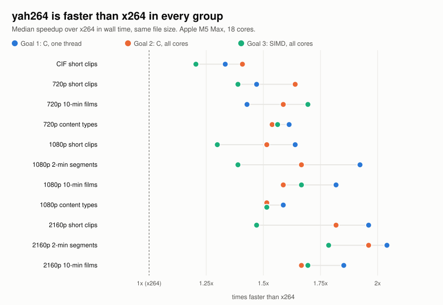
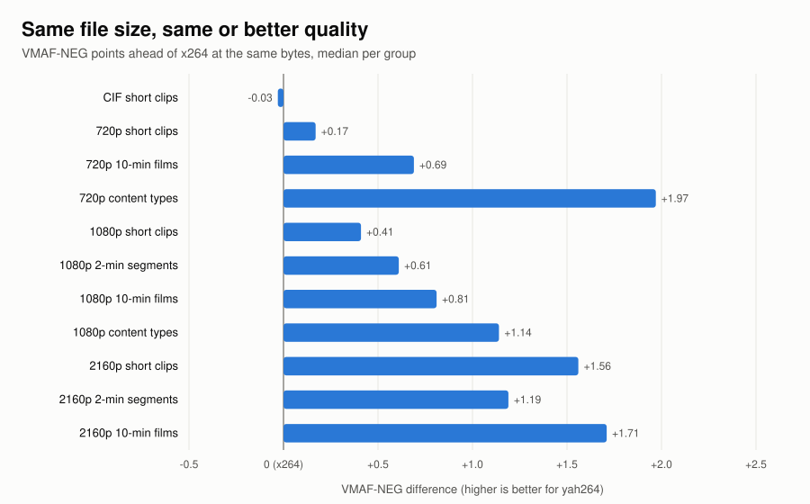
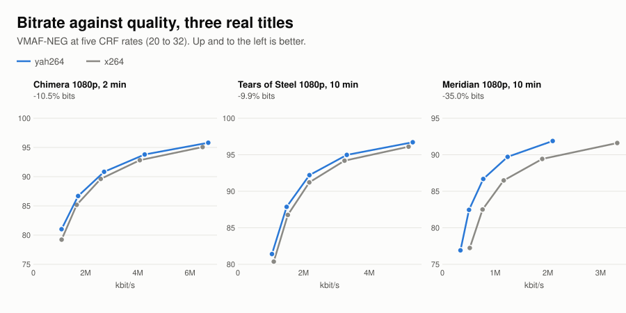
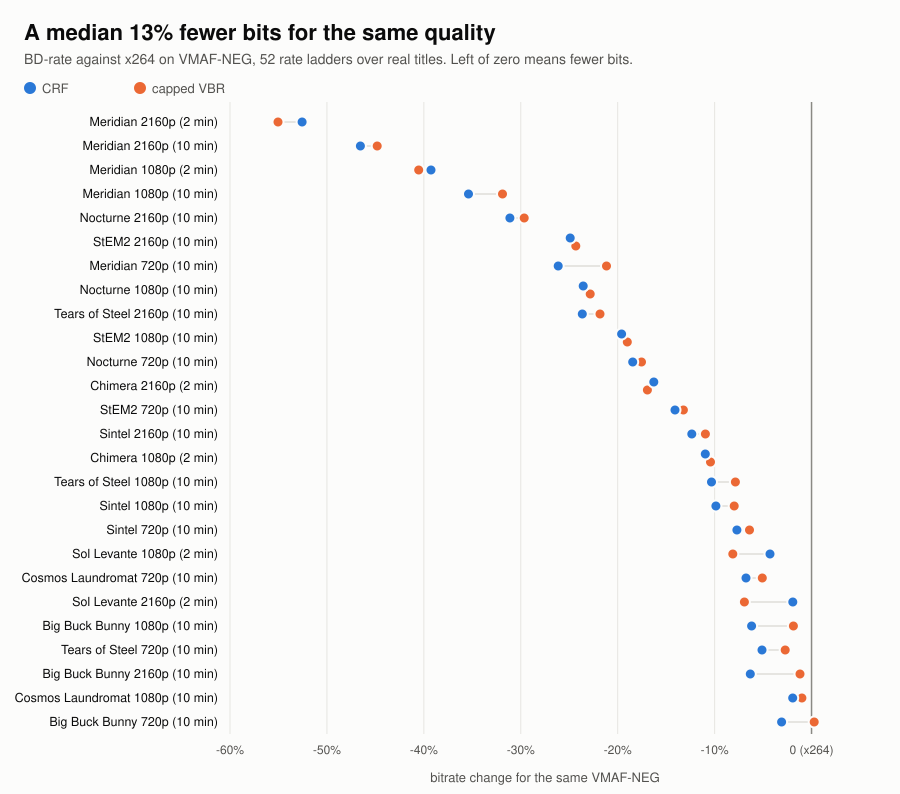

# Introducing yah264

yah264 is an H.264/AVC encoder that runs 1.2x to 2.1x faster than x264 across a wide range of test video. It needs a median 13% fewer bits for the same quality.

I've worked on video ingestion pipelines for over 15 years. The key goals are always "lowest cost" and "highest quality" for a given bitrate. And of course speed usually matters as well. This is my attempt at all three for anyone who would like to try yah264 out.

I started development on my MacBook Pro M5 Max, so most of the initial optimization was arm64 based. That worked for me because I've found that the lowest-cost instances for encoding are currently arm64. Graviton4 is generally in the range of 10-30% cheaper per frame encoded.

## Highlights

yah264 is faster than x264 in every group of the test corpus, from CIF to 4K. Each figure is the median speedup over x264 in wall time, at the same file size:

| build | Apple M5 Max | AWS Graviton4 |
|---|--:|--:|
| plain C, one thread | 1.39x to 2.13x | 1.75x |
| plain C, all cores | 1.41x to 2.04x | 2.27x |
| SIMD-optimized, all cores (yah264 NEON vs x264's assembly) | 1.22x to 1.89x | 1.43x |

On my Mac, each range runs from the slowest group's median to the fastest's. Speed and capped VBR were timed on commit 06a94fb4. Under a bitrate target its output is byte-identical to the current build's (commit 8f92edff). The current build changes CRF coding only, and at the same VMAF-NEG score its instruction count is within 0.5% of the timed build's. Where the source couldn't be fed as fast as yah264 encoded, the [results page](results.md) shows the reading as an upper bound.

- A median 13% fewer bits for the same quality over 52 rate ladders on real titles.
- 8-bit and 10-bit in one binary.
- CRF, ABR, capped CRF and CBR, with VBV and HRD signaling.
- Presets from `ultrafast` to `placebo`.

Every number is on the [results page](results.md). The page explains the method too. `make review` reruns a smaller HD board from the repository, so you can [check the results yourself](check-it-yourself.md).

<figure class="chart"></figure>

<figure class="chart"></figure>

<figure class="chart"></figure>

<figure class="chart"></figure>

## Built for per-shot encoding

Per-shot encoding gives each shot in a title its own settings. The search runs above the encoder. yah264 provides the options and a method to keep that orchestration simple. It finds the shots without a trial encode. It takes a plan of keyframes and quality offsets in a single encode. A shot encoded alone matches the same shot in the full encode, so trials are exact previews.

For most of the gain without a search, `--shot-crf` adjusts quality per shot in one pass. The options and a step-by-step method are in the docs:

- Shot-aware options: [Getting started](start.md)
- Orchestrator method: [the engine interface](https://github.com/terranvigil/yah264/blob/main/docs/engine-interface.md)

## Per-title encoding

- yah264 is the encoder inside a per-title search. For the search itself (bitrate ladders, convex hull, VMAF), see my [veo project](https://github.com/terranvigil/veo).

## Running it from ffmpeg

yah264 runs as a library inside ffmpeg:

```
ffmpeg -i in.mp4 -c:v libyah264 -preset medium -crf 23 out.mp4
```

The wrapper isn't upstream yet. It lives on the `yah264` branch of my [ffmpeg fork](https://github.com/terranvigil/FFmpeg). The [getting started](start.md) page has the build steps.

## On a Mac

`--hw videotoolbox` uses Apple's hardware encoder. It's faster and uses far less CPU, at lower quality. It's a good fit for previews and proxies.

## Still being optimized

x86-64 support (AVX2, plus AVX-512 where the chip has it) is working and verified. At one thread it already beats x264 on CPU time. With every core busy it still trails x264 on some clips. That's the next fix.

## Docs

- [How video encoding works](encoding.md)
- [How H.264 works](how-h264-works.html)
- [Getting started](start.md)
- [Results](results.md)
- [Check it yourself](check-it-yourself.md)
- Source: [github.com/terranvigil/yah264](https://github.com/terranvigil/yah264)

## Coming next

yah265 (HEVC) and yaav1 (AV1) are on the way. They share yah264's many-core pipeline and its correctness gate. Both build on what we learned here. Both will be released soon.

- yah265: coming soon
- yaav1: coming soon
