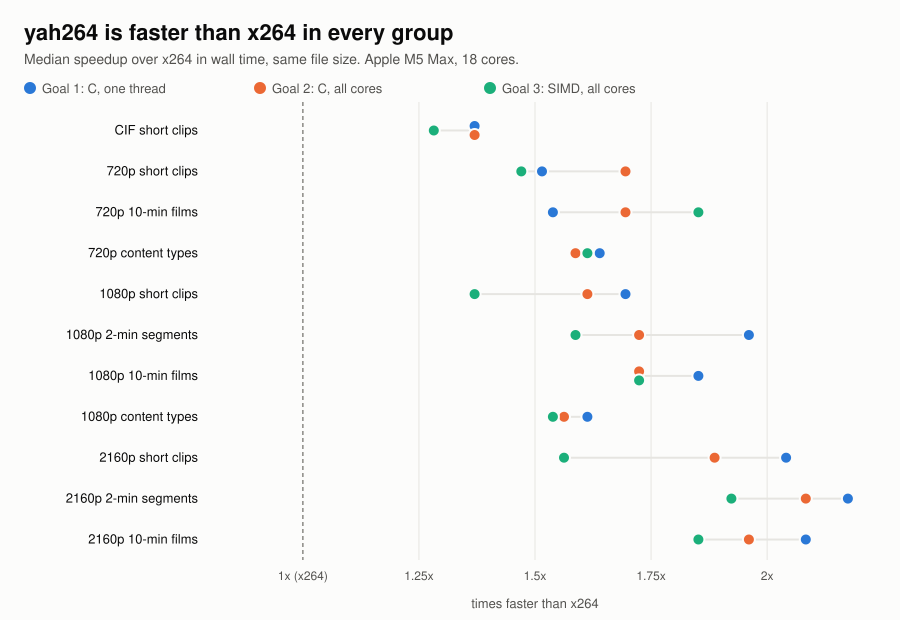
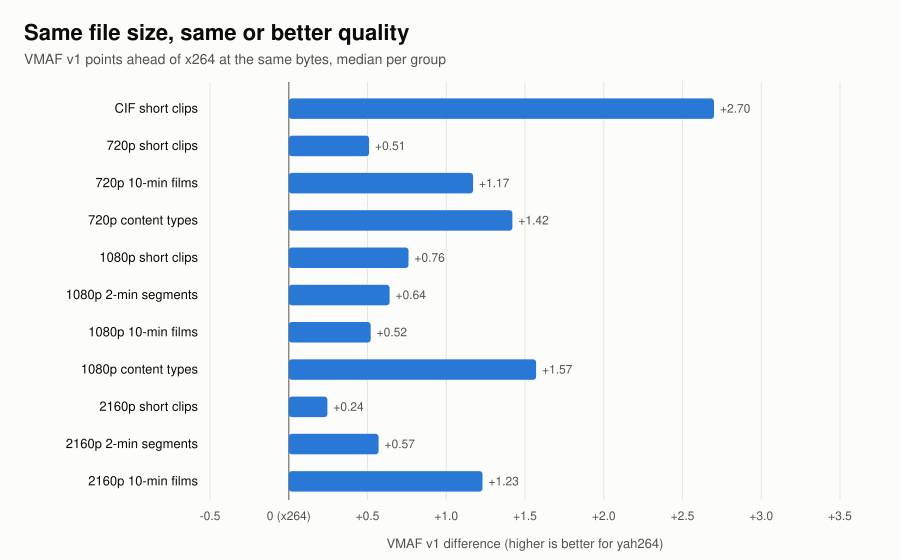
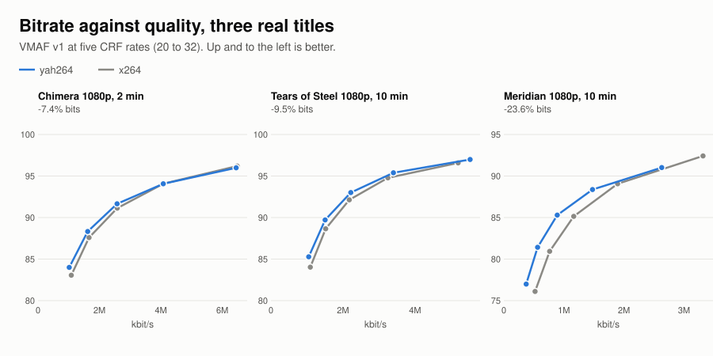
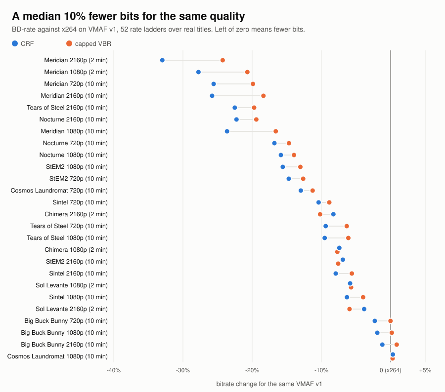

# Introducing yah264

yah264 is an H.264/AVC encoder that runs 1.28x to 2.17x faster than x264 across a wide range of test video. It needs a median 10% fewer bits for the same quality. The source is on [GitHub](https://github.com/terranvigil/yah264).

I've worked on video ingestion pipelines for over 15 years. The goals are always "lowest cost" and "highest quality" for a given bitrate. Speed usually matters too. This is my attempt at all three.

I developed on a MacBook Pro M5 Max, so most of the optimization started on arm64. That suits me, because the cheapest encoding instances I've found are arm64. Graviton4 is generally 10-30% cheaper per frame.

## Highlights

yah264 is faster than x264 in every group of the test corpus, CIF to 4K. Median wall-time speedup at the same file size:

| build | Apple M5 Max | AWS Graviton4 |
|---|--:|--:|
| plain C, one thread | 1.37x to 2.17x | 1.75x |
| plain C, all cores | 1.37x to 2.08x | 2.27x |
| SIMD-optimized, all cores (yah264 NEON vs x264's assembly) | 1.28x to 1.92x | 1.43x |

Mac ranges run from the slowest group's median to the fastest's.

- A median 10% fewer bits for the same VMAF v1 score, over 52 rate ladders on real titles.
- 8-bit and 10-bit in one binary.
- CRF, ABR, capped CRF and CBR, with VBV and HRD signaling.
- Presets from `ultrafast` to `placebo`.

The [results page](results.md) has every number and the method. To [check it yourself](check-it-yourself.md), `make review` in the [repository](https://github.com/terranvigil/yah264) reruns a smaller HD board.

<figure class="chart"></figure>

<figure class="chart"></figure>

<figure class="chart"></figure>

<figure class="chart"></figure>

## Built for per-shot encoding

Per-shot encoding gives each shot its own settings from a search that runs above the encoder. yah264 keeps that simple. It finds shots without a trial encode and takes a plan of keyframes and quality offsets in one encode. A shot encoded alone matches the same shot in the full encode, so trials are exact previews. For most of the gain without a search, `--shot-crf` adjusts quality per shot in one pass. See the [options](start.md) and the [orchestrator method](https://github.com/terranvigil/yah264/blob/main/docs/engine-interface.md).

## Per-title encoding

yah264 is the encoder inside a per-title search, which my [veo project](https://github.com/terranvigil/veo) runs: bitrate ladders, convex hull and VMAF.

## Running it from ffmpeg

yah264 runs as a library inside ffmpeg:

```
ffmpeg -i in.mp4 -c:v libyah264 -preset medium -crf 23 out.mp4
```

Until the wrapper is upstream, it lives on the `yah264` branch of my [ffmpeg fork](https://github.com/terranvigil/FFmpeg). See [getting started](start.md) for the build.

## On a Mac

`--hw videotoolbox` uses Apple's hardware encoder: faster and far lighter on CPU, but lower quality. It suits previews and proxies.

## Still being optimized

x86-64 works and is verified, with AVX2 and AVX-512 where the chip has it. At one thread it beats x264 on CPU time. The next fix is all-core speed, where it trails on some clips.

## Docs

- [How video encoding works](encoding.md)
- [How H.264 works](how-h264-works.html)
- [Getting started](start.md)
- [Results](results.md)
- [Check it yourself](check-it-yourself.md)
- Source: [github.com/terranvigil/yah264](https://github.com/terranvigil/yah264)

## Coming next

yah265 (HEVC) and yaav1 (AV1) are coming soon. They share yah264's many-core pipeline and correctness gate.
