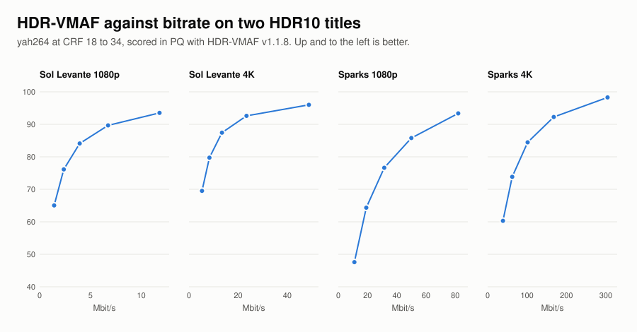
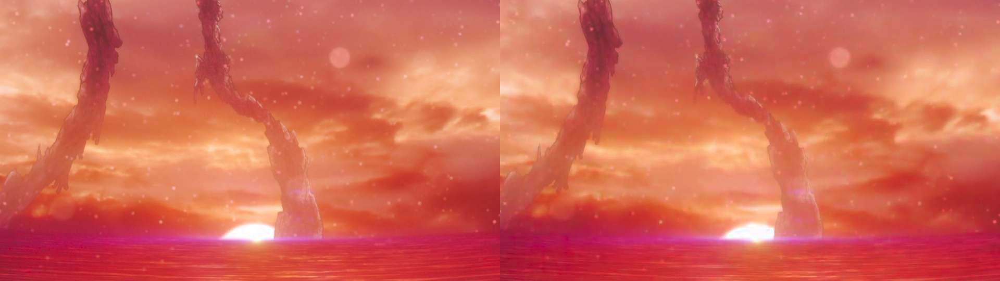

# HDR

yah264 encodes HDR10 and HLG as 10-bit H.264. ffprobe and MediaInfo read its
HDR10 output as HDR10.
We scored it on two open HDR10 masters with Netflix's HDR models for VMAF v1.

## Supported formats

| | how the stream says it | options |
|---|---|---|
| HDR10 | PQ transfer with BT.2020 primaries and matrix in the VUI, plus SMPTE ST 2086 mastering display and CTA-861.3 content light level SEI | `--transfer smpte2084 --colorprim bt2020 --colormatrix bt2020nc --mastering-display ... --cll ...` |
| HLG | HLG transfer in the VUI | `--transfer arib-std-b67 --colorprim bt2020 --colormatrix bt2020nc` |
| HLG, SDR-compatible | BT.2020 transfer in the VUI plus an alternative transfer SEI naming HLG. An SDR-only decoder still shows a picture | `--transfer bt2020-10 --alternative-transfer arib-std-b67 --colorprim bt2020 --colormatrix bt2020nc` |
| 10-bit 4:2:0, 4:2:2, 4:4:4 | High 10, High 4:2:2, High 4:4:4 Predictive | picked from the input, see [Getting started](start.md#bit-depth) |

There's no HDR10+ (SMPTE ST 2094-40) or Dolby Vision. Both target HEVC and AV1:
players don't read their dynamic metadata from H.264, and Dolby Vision's one
H.264 profile holds an SDR picture.

These options only label the stream. The encoder codes PQ and HLG like SDR.

## Encoding HDR10

The CLI reads 10-bit Y4M, so ffmpeg decodes the master and pipes it in:

```
ffmpeg -i master.mov -pix_fmt yuv420p10le -strict -1 -f yuv4mpegpipe - |
  y264 --input-y4m - -o out.264 --crf 22 \
    --colorprim bt2020 --transfer smpte2084 --colormatrix bt2020nc --range limited \
    --mastering-display 'G(13250,34500)B(7500,3000)R(34000,16000)WP(15635,16450)L(10000000,1)' \
    --cll 1000,400
```

Y4M can't carry transfer or primaries, which therefore go on the command line
under ffmpeg's and x264's names. `bt2020nc`, H.273 matrix code 9, is the
non-constant-luminance matrix. `bt2020` means the same.

`--mastering-display` lists green, blue, red, then the white point, in the H.264
spec's order. Chromaticities are in units of 0.00002 and luminance in 0.0001
cd/m². The example is a P3 D65 display with a 1000-nit peak.

`--cll` takes the title's MaxCLL and MaxFALL in cd/m². ffprobe shows them under
`-show_frames` when the video stream has them and `-show_streams` when the
container does. Otherwise `scripts/hdr_check.sh` measures them on the master's
RGB before 4:2:0, because RGB rebuilt from subsampled chroma overshoots at
bright edges.

With `-c:v libyah264` from a 10-bit build, a tagged input's color description
and HDR10 metadata pass through. For untagged input such as Y4M, tag the frames
and pass the metadata:

```
ffmpeg -i master.y4m \
  -vf setparams=color_primaries=bt2020:color_trc=smpte2084:colorspace=bt2020nc:range=tv \
  -c:v libyah264 -crf 22 \
  -mastering-display 'G(13250,34500)B(7500,3000)R(34000,16000)WP(15635,16450)L(10000000,1)' \
  -cll 1000,400 out.mp4
```

The mastering display and light level SEI go in-band before every IDR, and
before each recovery point under `--open-gop` or `--intra-refresh`. A player
finds them at any keyframe. The wrapper's MP4 and MPEG-TS files carry them the
same way.

## What a player reads

ffprobe on one of the encodes below, with
`ffprobe -show_streams -show_frames -read_intervals %+#1 out.264`, trimmed:

```
profile=High 10
pix_fmt=yuv420p10le
color_range=tv
color_space=bt2020nc
color_transfer=smpte2084
color_primaries=bt2020
side_data_type=Mastering display metadata
...
side_data_type=Content light level metadata
max_content=1170
max_average=1022
```

MediaInfo on the same file:

```
Format profile                           : High 10@L5
HDR format                               : SMPTE ST 2086, HDR10 compatible
Bit depth                                : 10 bits
Color primaries                          : BT.2020
Transfer characteristics                 : PQ
Matrix coefficients                      : BT.2020 non-constant
Mastering display color primaries        : Display P3
Mastering display luminance              : min: 0.0001 cd/m2, max: 1000 cd/m2
Maximum Content Light Level              : 1170 cd/m2
Maximum Frame-Average Light Level        : 1022 cd/m2
```

Sol Levante's light levels sit a little above its 1000-nit grading display
because its brightest opening frames average about 1020 nits.

An HLG encode reads `Transfer characteristics : HLG`. The SDR-compatible form
reads `HLG / BT.2020 (10-bit)`, where ffmpeg takes the HLG transfer from the SEI.

## Quality on HDR-VMAF

VMAF v1's HDR models, HDR-VMAF v1.1.8, rate the HDR picture itself by scoring
both pictures as PQ in ICtCp. Each encode is scored against its source at
the same size: 4K on the 4K model at 1.5 picture heights, 1080p on the 1080p
model at 3. Sparks, at 59.94 fps, uses the high-frame-rate versions. CAMBI
measures banding in its PQ mode in the same run.

| clip | content | frames | source |
|---|---|---|---|
| Sol Levante | animation, a sunset sky over the sea | 240 at 24 fps, from 2:40 | ProRes 4444 XQ, 12-bit PQ, BT.2020, 1000 nits |
| Sparks | live action, a grinder throwing sparks | 300 at 59.94 fps, frames 5880 to 6179 | 16-bit PQ BT.2020 TIFF frames, 1000 nits, center-cropped to 3840x2160 |

Both are [Netflix Open Content](https://opencontent.netflix.com/) under
[CC BY 4.0](https://creativecommons.org/licenses/by/4.0/). Each was converted
to 10-bit 4:2:0 PQ at 3840x2160 and 1920x1080. Every encode ran from those at
the default preset with 6 threads.

<figure class="chart"></figure>

Sol Levante at 4K reaches HDR-VMAF 87 at 13 Mbit/s with CRF 26. Sparks, with
film grain under thousands of moving sparks, needs about 100 Mbit/s at 4K to
reach 84.

CAMBI is 0 for no banding and climbs as banding worsens. Clip averages stay at
about 1.2 or below. They hide Sol Levante's flat, bright underwater opening,
which scores close to 0 in the source. At CRF 26 the encode smooths its faint
particles into patches, which is the high worst-frame CAMBI below. No Sparks
frame passes 0.5. Smooth gradients are where the encoder has most to gain on HDR.

| clip | CRF | Mbit/s | HDR-VMAF | CAMBI mean | CAMBI worst frame |
|---|--:|--:|--:|--:|--:|
| Sol Levante 1080p | 22 | 6.7 | 89.7 | 0.45 | 3.6 |
| Sol Levante 1080p | 26 | 3.9 | 84.1 | 0.85 | 7.9 |
| Sol Levante 4K | 22 | 23.4 | 92.6 | 0.47 | 4.1 |
| Sol Levante 4K | 26 | 13.4 | 87.4 | 0.98 | 8.9 |
| Sparks 1080p | 22 | 50.0 | 85.8 | 0.09 | 0.24 |
| Sparks 1080p | 26 | 31.4 | 76.6 | 0.19 | 0.42 |
| Sparks 4K | 22 | 167.8 | 92.3 | 0.14 | 0.34 |
| Sparks 4K | 26 | 101.5 | 84.5 | 0.20 | 0.47 |

At 3840x2160 the defaults declare Level 6.0, because the decoded picture buffer
holds more frames than Level 5.1 allows. Many 4K TVs stop at 5.1 or 5.2.

For TV delivery pass `--level 5.1`, or 5.2 at 50 or 60 fps. The buffer then
fits, keeping the B-pyramid and three references at some threaded speed.

## The pictures

Each image is a full-resolution 960x540 crop of frame 120 of a 4K encode,
source on the left and yah264 at CRF 26 on the right. Both go through the same
Hable tone map to SDR with a 1000-nit peak, since not every screen shows PQ.

<figure class="chart"></figure>

The sky and the sun's edge come through intact. Sparks is harder:

<figure class="chart"></figure>

The sparks and clasp keep their edges. Some fine grain on the jacket smooths.

## Run it yourself

`scripts/hdr_check.sh` fetches the two clips, prepares them, encodes the CRF
ladder and scores it. It needs libvmaf built with zimg and the
`hdr_vmaf_v1.1.8` models from the [VMAF repository](https://github.com/Netflix/vmaf).

`scripts/hdr_check.sh meta` checks signaling instead. It encodes short HDR10,
HLG and SDR-compatible HLG spans with yah264 and x264 on the same options,
through each CLI and ffmpeg, and prints what ffprobe and MediaInfo read, field
by field. Every color and HDR field matches. Only the declared level differs.
