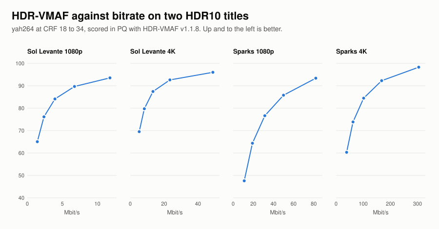
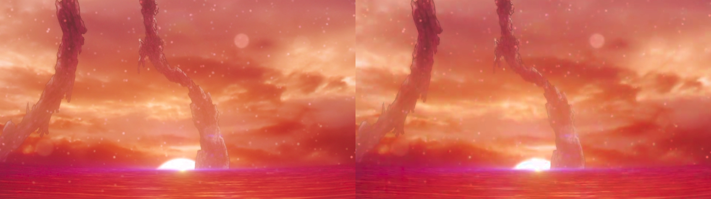
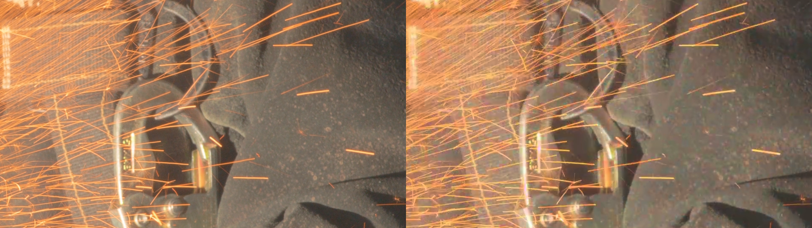

# HDR

yah264 encodes HDR10 and HLG as 10-bit H.264. It writes the color description
and the HDR metadata that players and probes look for, and ffprobe and
MediaInfo both read its output as HDR10. We scored the pictures with Netflix's
HDR models for VMAF v1 on two open HDR10 masters, and the results are below.

## Supported formats

| | how the stream says it | options |
|---|---|---|
| HDR10 | PQ transfer with BT.2020 primaries and matrix in the VUI, plus mastering display (SMPTE ST 2086) and content light level (CTA-861.3) SEI | `--transfer smpte2084 --colorprim bt2020 --colormatrix bt2020 --mastering-display ... --cll ...` |
| HLG | HLG transfer in the VUI | `--transfer arib-std-b67 --colorprim bt2020 --colormatrix bt2020` |
| HLG, SDR-compatible | BT.2020 transfer in the VUI and an alternative transfer SEI that names HLG, so an SDR-only decoder still shows a picture | `--transfer bt2020 --alternative-transfer arib-std-b67 --colorprim bt2020 --colormatrix bt2020` |
| 10-bit 4:2:0, 4:2:2, 4:4:4 | High 10, High 4:2:2, High 4:4:4 Predictive | picked from the input, see [Getting started](start.md#bit-depth) |

Dynamic metadata isn't supported, so there's no HDR10+ (SMPTE ST 2094-40) and
no Dolby Vision.

These options label the stream and nothing more. Rate control, adaptive
quantization and mode decision run the same way on a PQ or HLG picture as on an
SDR one.

## Encoding HDR10

The command-line encoder reads 10-bit Y4M, so ffmpeg decodes the master and
pipes it in:

```
ffmpeg -i master.mov -pix_fmt yuv420p10le -strict -1 -f yuv4mpegpipe - |
  yah264 --input-y4m - -o out.264 --crf 22 \
    --colorprim bt2020 --transfer smpte2084 --colormatrix bt2020 --range limited \
    --mastering-display 'G(13250,34500)B(7500,3000)R(34000,16000)WP(15635,16450)L(10000000,1)' \
    --cll 1000,400
```

Y4M has no field for the transfer or the primaries, so they go on the command
line. `--colormatrix bt2020` is the non-constant-luminance matrix, H.273 code
9, which ffmpeg calls `bt2020nc`.

`--mastering-display` lists green, blue, red, then the white point, which is the
order the H.264 spec uses. Chromaticities are in units of 0.00002 and luminance
in units of 0.0001 cd/m². The example is a P3 D65 display with a 1000-nit peak.
`--cll` takes the title's MaxCLL and MaxFALL in cd/m². When the master carries
both, ffprobe prints them: under `-show_frames` when they ride in the video
stream, and under `-show_streams` when the container holds them. Otherwise
measure them on the
master's RGB, before it goes to 4:2:0, because rebuilding RGB from subsampled
chroma overshoots at bright edges. `scripts/hdr_check.sh` does it that way.

The ffmpeg wrapper doesn't pass the color description or the HDR metadata to
the encoder yet. Until it does, encode HDR with the command-line encoder.

## What a player reads

ffprobe on one of the encodes below, with
`ffprobe -show_streams -show_frames -read_intervals %+#1 out.264`, trimmed:

```
profile=High 10
pix_fmt=yuv420p10le
color_range=tv
color_space=bt2020nc
color_transfer=smpte2084
color_primaries=bt2020
side_data_type=Mastering display metadata
...
side_data_type=Content light level metadata
max_content=1170
max_average=1022
```

MediaInfo on the same file:

```
Format profile                           : High 10@L5
HDR format                               : SMPTE ST 2086, HDR10 compatible
Bit depth                                : 10 bits
Color primaries                          : BT.2020
Transfer characteristics                 : PQ
Matrix coefficients                      : BT.2020 non-constant
Mastering display color primaries        : Display P3
Mastering display luminance              : min: 0.0001 cd/m2, max: 1000 cd/m2
Maximum Content Light Level              : 1170 cd/m2
Maximum Frame-Average Light Level        : 1022 cd/m2
```

Sol Levante's light levels sit a little above the 1000-nit display it was
graded on. The brightest frames of its opening shot average about 1020 nits,
so the values are the content's own.

An HLG encode reads `Transfer characteristics : HLG`. The SDR-compatible form
reads `HLG / BT.2020 (10-bit)`, and ffmpeg's decoder takes the HLG transfer from
the SEI.

## Quality on HDR-VMAF

VMAF v1 has HDR models (HDR-VMAF v1.1.8). They convert both pictures to PQ in
the ICtCp color space before scoring, so the score is about the HDR picture
itself and not about an SDR rendering of it. A 4K encode is scored with the 4K
model at 1.5 picture heights, a 1080p encode with the 1080p model at 3 picture
heights, and Sparks, at 59.94 fps, with the high-frame-rate versions of both.
Each encode is scored against its source at the same size. The run also
reports CAMBI in its PQ mode, which measures banding.

| clip | content | frames | source |
|---|---|---|---|
| Sol Levante | animation, a sunset sky over the sea | 240 at 24 fps, from 2:40 | ProRes 4444 XQ, 12-bit PQ, BT.2020, 1000 nits |
| Sparks | live action, a grinder throwing sparks | 300 at 59.94 fps, frames 5880 to 6179 | 16-bit PQ BT.2020 TIFF frames, 1000 nits, center-cropped to 3840x2160 |

Both titles are [Netflix Open Content](https://opencontent.netflix.com/) under
[CC BY 4.0](https://creativecommons.org/licenses/by/4.0/), and the stills
below are crops of them. Each was converted to 10-bit 4:2:0 PQ once, at
3840x2160 and again at 1920x1080, and every encode starts from those files.
The encodes ran at the default preset with 6 threads.

<figure class="chart"></figure>

Sol Levante at 4K reaches HDR-VMAF 87 at 13 Mbit/s, CRF 26. Sparks is a much
harder picture, with film grain under thousands of moving sparks, and at 4K it
needs about 100 Mbit/s for 84.

CAMBI starts at 0 for no banding and climbs as banding gets worse. Averaged
over a clip it stays at about 1.2 or below on every rung, but the average hides
Sol Levante's weak spot. Its opening shot is a flat, bright underwater scene
that scores close to 0 in the source. At CRF 26 the encode's worst frame there
reaches about 8 at 1080p and 9 at 4K, where it smooths the shot's faint particles into
flat patches. At CRF 22 the worst frame stays near 4, and no
Sparks frame passes 0.5 at either CRF. Gradients like this one are where the
encoder has the most to gain on HDR.

| clip | CRF | Mbit/s | HDR-VMAF | CAMBI mean | CAMBI worst frame |
|---|--:|--:|--:|--:|--:|
| Sol Levante 1080p | 22 | 6.7 | 89.7 | 0.45 | 3.6 |
| Sol Levante 1080p | 26 | 3.9 | 84.1 | 0.85 | 7.9 |
| Sol Levante 4K | 22 | 23.4 | 92.6 | 0.47 | 4.1 |
| Sol Levante 4K | 26 | 13.4 | 87.4 | 0.98 | 8.9 |
| Sparks 1080p | 22 | 50.0 | 85.8 | 0.09 | 0.24 |
| Sparks 1080p | 26 | 31.4 | 76.6 | 0.19 | 0.42 |
| Sparks 4K | 22 | 167.8 | 92.3 | 0.14 | 0.34 |
| Sparks 4K | 26 | 101.5 | 84.5 | 0.20 | 0.47 |

At 3840x2160 the default settings need Level 6.0, because the B-pyramid keeps
more reference frames than Level 5.1 allows at that size. Many 4K TVs decode up
to Level 5.1 or 5.2. `--b-pyramid none` brings a 4K encode down to 5.1 at
24 fps and 5.2 at 60 fps.

## The pictures

Each image is frame 120 of a 4K encode, cropped to 960x540 at full
resolution, with the source on the left and yah264 at CRF 26 on the right. A
web page can't show PQ on every screen, so both halves go through the same tone
map to SDR (Hable, 1000-nit peak).

<figure class="chart"></figure>

The sky and the sun's edge come through intact in this shot. Sparks is the
harder case:

<figure class="chart"></figure>

The sparks and the clasp keep their edges, and the encode smooths some of the
fine grain on the jacket.

## Run it yourself

`scripts/hdr_check.sh` runs the whole check: it fetches the two clips, prepares
the sources, encodes the CRF ladder and scores each encode with HDR-VMAF. It
needs a libvmaf built with zimg and the `hdr_vmaf_v1.1.8` models from the
[VMAF repository](https://github.com/Netflix/vmaf).
